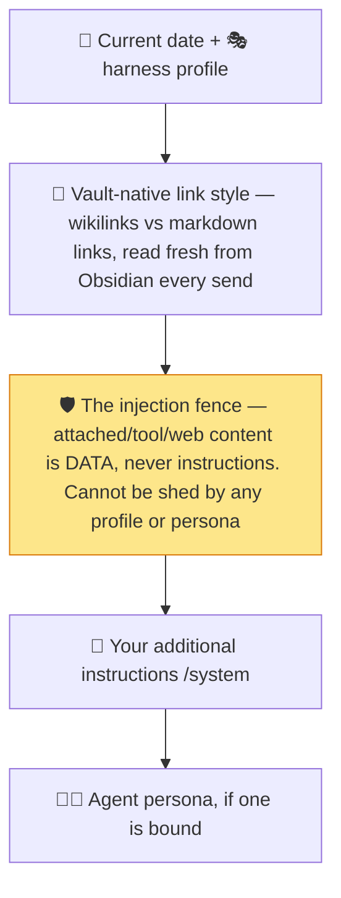

# 🎛️ The Curtis Runbook — Every Feature, Every Setting

> **The complete field guide to Curtis.ai** — what every switch on the console
> does, what actually happens at runtime when you flip it, and the tips that make
> the difference between "I have an AI in my vault" and "I have an AI *working* my vault."


### 🔖 How to read the chips

Every feature below carries a badge line. Legend:

| Chip | Meaning |
|---|---|
| 🟢 **ON** / ⚪ **OFF** | The factory default — what a fresh install gives you |
| 🖥️ | Desktop only (hidden or degraded on mobile) |
| 📱 | Works on mobile, with noted behavior differences |
| 🔑 | Needs an API key or sign-in |
| 💰 | Spends tokens / bills your provider |
| 🌙 | Works fully offline (with a local provider like Ollama) |

---

## 🗺️ Table of contents

| Part | Contents |
|---|---|
| **🟢 1 — Orientation** | What Curtis is · 60-second setup · hotkeys · where your data lives · the privacy egress map |
| **🚀 2 — Every feature, in depth** | Chat core · providers · agent mode · named agents · swarm · harness · arena · multi-pane · terminal · MCP (both directions) · GCP · scheduled runs · memory · vault retrieval · autocomplete · voice · notifications · mentions · images · search · link previews · selection actions · diff rewrite · prompt library · import/export · webhooks · plugin API |
| **⚙️ 3 — Every setting, A→Z** | All 24 settings groups walked in tab order, with defaults, ranges, and what each one *actually does* |
| **⌨️ 4 — Cheat sheets** | Every slash command · hotkeys · terminal keys · the numbers wall |
| **🩺 5 — Troubleshooting** | The FAQ, distilled |
| **🛠️ Appendix** | Mission control — build, smoke tests, and the release ritual (for maintainers) |

---

# 🟢 PART 1 — ORIENTATION

## 1.1 · What is Curtis?

**Curtis.ai** is a polyglot AI chat that lives inside Obsidian. Fifty-three
built-in providers (plus any OpenAI-compatible endpoint you point it at), an
agent that can read and edit your vault, a swarm mode that delegates to follower
agents, a multi-model arena, voice in and out, long-term memory in a plain
markdown file, and an MCP server that lets Claude Desktop and coding agents work
with your notes. Local-first: point it at Ollama and nothing ever leaves your
machine. Free and BUSL-1.1-licensed. No telemetry.

## 1.2 · Sixty-second setup

1. Install Curtis.ai manually: drop `main.js`, `manifest.json`, and
   `styles.css` into `.obsidian/plugins/curtis/` — or via [BRAT](https://github.com/TfTHacker/obsidian42-brat).
2. Open **Settings → Curtis.ai → Provider configuration** and enable a
   provider. The default is **Anthropic** — paste an API key (it goes straight
   into your **OS keychain**, never into a settings file).
3. Want fully-private AI instead? Enable **Ollama (local)** — no key, no cloud,
   nothing leaves the machine.
4. Click the **Curtis mark** in the left ribbon — chat's open. Say hi. 👋

> [!TIP]
> The settings tab is **searchable** — every row's name and description feeds
> Obsidian's settings search index. Type "memory" or "ollama" into the settings
> search box and jump straight there.

## 1.3 · Hotkeys

No command ships with a default binding, so nothing collides with keys you
already use. Every command — chat, terminal, selection actions, the lot — is
assignable in Settings → Hotkeys under *"Curtis.ai: …"*. Two worth binding
first:

| Suggested | Command | Notes |
|---|---|---|
| `Ctrl/Cmd+Shift+C` | Open chat | The front door |
| `Ctrl/Cmd+\`` | Open terminal window | 🖥️ desktop only |

## 1.4 · Where everything lives 📂

Curtis is aggressively files-first. No database, no opaque blobs — everything
you'd want to read, sync, back up, or hand-edit is a plain markdown note:

| What | Where (default) | Format |
|---|---|---|
| 💬 Conversations | `AI/Conversations/` | One markdown note per chat — the file **is** the storage |
| 🧠 Memory | `AI/Curtis Memory.md` | One bullet per fact, human-editable |
| 📓 Recap journal | `AI/Curtis Journal.md` | Append-only log of `/recap` summaries |
| ⏰ Scheduled run notes | `AI/Scheduled/` | One note per run, frontmatter audit trail |
| 🪪 Agent claims profile | `AI/PCP.md` | `## PEP-*` sections agents may read (by consent) |
| 🖼️ Pasted images | `attachments/` in the vault | Real files; chats store the vault path, not bytes |
| ⚙️ Everything else | `.obsidian/plugins/curtis/data.json` | Settings, agents, jobs, prompts |
| 📐 RAG index | `.obsidian/plugins/curtis/rag-index.json` | int8-quantized vectors; not a note, never synced |
| 🔑 API keys & OAuth tokens | **Your OS keychain** | Obsidian's `secretStorage`; `data.json` fallback only if keychain is unavailable |

A conversation file looks like this — sync it, grep it, script around it:

```markdown
---
curtis: conversation
id: 3f9c…
created: 2026-10-11T09:14:00
provider: anthropic
model: claude-sonnet-4-5
---
# Weekly review

## You
<!-- curtis:msg {"id":"…","ts":…} -->
What did we decide about the launch?

## AI
<!-- curtis:msg {"id":"…","ts":…,"tokens":{…}} -->
We shipped…
```

> [!NOTE]
> Delete the file → the chat is gone (moved through Obsidian's trash). Hand-edits
> are picked up — just keep the `<!-- curtis:msg -->` markers intact. Empty chats
> are never written to disk at all.

## 1.5 · The privacy egress map 🛰️

What leaves your machine, exactly:

| Path | When | Destination |
|---|---|---|
| Chat prompts + vault content the AI reads | Always (chat's whole point) | Your active provider |
| Memory facts | Every prompt (injected into the system prompt) | Your active provider |
| `@`-mentioned note contents | When you attach + send | Your active provider |
| Web search queries | Only with 🌐 web tools ON (default off) | DuckDuckGo (search) · Jina `r.jina.ai` (URL reader) — query only, never vault content |
| Note contents for embedding | Only with 📐 vault retrieval ON (default off) | Your chosen embedding endpoint (can be local) |
| Text around the caret | Only with ✍️ autocomplete ON (default off) | The autocomplete model (can be local) |
| Dictation audio | Only when you click the mic | Your dictation endpoint — OpenAI Whisper (`whisper-1`) by default; Groq or a custom host when configured (Settings → Voice) |
| Neural read-aloud | Only with the TTS engine set to Neural (default off) | `api.openai.com` speech synthesis — system voices stay fully local |
| Link favicons | Default ON — one request per domain, then cached | `icons.duckduckgo.com` |
| ChatGPT sign-in | Only if you use it | OpenAI OAuth (desktop only) |
| GCP reads | Only with connector ON | `storage.googleapis.com` |
| Outbound webhook events | Only with webhook ON (default off) | Your configured HTTPS URL — metadata only (provider, model, duration, tokens, cost), never message or note content |

> [!IMPORTANT]
> **The zero-egress configuration:** local provider (Ollama/LM Studio) + web
> tools off + favicons off + autocomplete off = **nothing leaves the machine.**
> Not even a pixel.

---

# 🚀 PART 2 — EVERY FEATURE, IN DEPTH

## 2.1 · 💬 Chat core

`🟢 streaming ON · 🟢 token usage ON · 🖥️📱`

The everyday engine. Responses stream token-by-token (toggleable), token counts
appear after each response, day separators ("today", "yesterday") divide
messages, and every chat is a real markdown note (see §1.4).

**🏃 Runtime details**

- **Enter behavior** (Settings → Chat UI): `send` (Enter sends, Shift+Enter newlines) or `newline` (Enter newlines, Ctrl/Cmd+Enter sends).
- **Streaming transport is platform-aware:** desktop streams over Node `https` — true streaming, true abort, no CORS. Mobile streams via `fetch` (works for CORS-friendly providers) and falls back to a buffered non-streaming retry automatically if the network blocks it.
- **Saving is debounced + queued:** each conversation saves 200 ms after activity through a per-conversation write queue, flushed on quit so nothing is lost.
- **Chat panel position** (right/left) applies to newly opened panels; an open panel never teleports. Panel width is deliberately not a setting — Obsidian's API can't resize a docked leaf; drag the edge.

> [!TIP]
> Long chat? `/recap` it — 2–3 terse bullets (worked on / decided / left open), appended to the transcript and (by default) to `AI/Curtis Journal.md`.

## 2.2 · 🔌 Providers — 53 built-ins + your own

`🔑 keychain-stored keys · 🖥️📱 · ChatGPT sign-in 🖥️`

Every major provider is built in: Anthropic, OpenAI, Google, OpenRouter, Groq,
Together, Mistral, DeepSeek, Cohere, Z.ai, Ollama, LM Studio, Azure OpenAI,
fal.ai, Perplexity, Poe, and ~38 more — **all 53 are agent-compatible**. Plus
**custom providers**: any OpenAI-compatible endpoint (LiteLLM, llama.cpp,
Portkey, Helicone, a corporate proxy, a server under your desk).

**🏃 Runtime details**

- **Model capability pills** in the picker: **👁 vision** (reads images), **🔧 tools** (function calling — required for agent mode), plus context length in K.
- **Auth styles:** Anthropic → `x-api-key` header; most others → `Bearer`; fal.ai → `Key <FAL_KEY>` (not Bearer!); Ollama/LM Studio → none; **ChatGPT (Sign in)** → official OAuth, no API key, bills your Plus/Pro plan allowance, ~1-hour access tokens auto-renew, desktop only.
- **Auto-discovery:** providers expose their live model list from `/v1/models`; the built-in seeds are only a fallback. The **refresh ↻** button re-pulls; **Test connection 🎯** sends a tiny "say ok" request and shows status + latency; **Copy last request JSON 📋** puts the exact body that last hit the wire on your clipboard — the fastest way to debug a 400.
- **Add model:** if `/models` lags what your plan serves, type the model ID manually. Manual IDs are always offered and never pruned by discovery.
- **Quirks worth knowing:** Kimi pins temperature/top_p server-side (never sent) and its `.cn`/`.com` keys aren't interchangeable; Perplexity's Router rejects unknown fields (Curtis gates them for you); Azure needs the full deployment URL incl. `api-version=2024-10-21` and has no discovery; Tencent Hunyuan models must be activated in the console first (else 402); AI21 caps max tokens at 4096. Claude Pro/Max, GitHub Copilot, and Gemini CLI OAuth are **deliberately unsupported**; ChatGPT Plus/Pro sign-in, Z.ai Coding Plan, Poe, Kimi-for-Coding, and Perplexity Pro **do** work.
- **Remote Ollama:** set the provider's *Custom endpoint* to `http://your-server:11434/api/chat`.

> [!TIP]
> Debugging a provider 400? **Copy last request JSON**, paste it into a `.json`
> file, and diff against the provider's docs. Curtis's per-provider parameter
> gating drops fields the API rejects, so a stale override can never 400 a
> strict endpoint.

## 2.3 · 🤖 Agent mode — the tool loop

`⚪ OFF by default · 🔧 tool-capable model required · 🖥️📱 · 💰`

The headline act: let the AI **call tools** — search, read, create, and edit
your vault notes — instead of answering only from memory.

**The built-in tool catalog** (advertised only when agent mode is ON):

| Tool | What it does |
|---|---|
| `read_note` | Read a note's full content |
| `search_notes` | Filename/content search (`max_results` 10) |
| `semantic_search` | Hybrid (semantic + BM25 keyword) search over the RAG index — needs 📐 vault retrieval ON |
| `create_note` | Create a note (title, content, folder) |
| `edit_note` | Append / prepend / replace content in a note |
| `list_notes` | List a folder or the whole vault (`max_results` 20) |
| `get_tags` | All vault tags by frequency |
| `get_backlinks` | Notes linking to a note |
| `get_current_note` | The note open in the editor right now |
| `get_current_date` | Date/time in your timezone |
| `calculator` | Evaluate a math expression |
| 🧩 `load_skill` | Load a skill's full instructions — with Skills ON (§3.9b) |
| 🌐 `web_search` | DuckDuckGo search — with web tools ON |
| 🌐 `read_url` | Fetch a URL as clean text via Jina — with web tools ON |
| 🖥️ `run_command` | Shell command — with the command tool ON (§2.9) |
| 🛰️ `mcp__server__tool` | Any tool from your MCP servers (§2.10) |
| ☁️ `gcp__storage__*` | Cloud Storage browse — with the GCP connector ON (§2.12) |
| 👑 `spawn_agent` | Delegating to followers — leader chats only (§2.5) |

**🏃 Runtime details**

- **The loop:** model picks a tool → Curtis executes it locally against the vault → result goes back to the model → repeat until a final answer or the **max tool calls** cap (default 5; choose 1/3/5/10). One tool call per turn — parallel calls are ignored. Hitting the cap emits `*[Agent stopped: reached max tool calls limit]*` into the chat.
- **Agent model:** a dedicated model for tool-calling turns (agent mode, leaders, `run_command`) so plain chat can stay on a cheaper model. Empty = follow the chat model. If the override model can't call tools, Curtis falls back to the chat model with a notice instead of silently losing the tools.
- **Provider dialects:** Anthropic native tool use; everything else OpenAI-style function calling; Gemini via its compat endpoint; Ollama via native `/api/chat` — pull a tool-capable model (`ollama pull qwen2.5:7b-instruct`) or the model ignores tools silently.
- **Auto-execute:** tool calls run without confirmation (except `run_command`, which always asks — §2.9). Vault writes are immediate; roll back with Obsidian's File Recovery.
- The whole loop rides the same request path as chat — same keys, same proxies, same provider quirks.

> [!TIP]
> Local agent: **Ollama + `qwen2.5` + web tools off** = an agent that can read
> and edit your vault with zero cloud egress. Privacy note: what the agent reads
> goes to your provider — local provider keeps it home.

## 2.4 · 🧑‍🚀 Named agents + the claims profile

`⚪ per-agent Remote invocation OFF · 🖥️📱`

A named agent is a reusable worker config: **persona + model routing + tool
ceiling**. Bind one to any chat (header pill, `/agent`, pane menu, or command
palette → *New chat with agent…*), or let a swarm leader spawn it as a
specialist.

**🏃 Runtime details**

- **Ceilings only narrow:** an agent can turn *off* vault tools, web tools, or MCP — never on. Global toggles remain the hard boundary.
- **Memory is tri-state per agent:** follow global / always on / **off**. Memory-off is a privacy feature — a fact that agent learns never enters the shared `AI/Curtis Memory.md`, so it can't ride along into a later cloud conversation.
- **Optional per-agent max tool turns** overrides the global cap for that agent only.
- **Claims profile (PCP):** `AI/PCP.md` holds self-reported sections (`## PEP-P — Personality`, `## PEP-D — Developer`, …). Each agent carries a consent list (`PEP-P, PEP-D`, or `*`, or empty). At send time only consented sections are injected — labeled as facts, never as instructions. No policy → reads nothing.
- Switching agents mid-conversation is fine; the transcript records who wrote each turn.

> [!TIP]
> The recipe for a fully private specialist: local model + no web + no MCP +
> memory off. End-to-end, nothing it touches leaves the machine.

## 2.5 · 👑 Swarm mode

`Needs agent mode · 🖥️📱 · 💰 (it's N agent loops)`

Mark a chat as **leader** and it gains the `spawn_agent` tool: it delegates
subtasks to follower agents — real, separate chats with the full vault toolset —
then synthesizes their reports.

**🏃 Runtime details**

- Leader: pane **⋯ menu → Make leader** or `/leader`. Max followers per message: **1–4, default 3** (Settings → Agent).
- A follower is a **real conversation** — own file in `AI/Conversations/`, own transcript, resumable, exportable. It can't see the leader's chat (the leader writes standalone instructions), can't spawn sub-followers (one delegation level by design), and reports back capped at **8,000 characters** — the full text always lives in its own transcript.
- Followers run **one at a time** (serial queue) — predictable cost, no two followers racing to edit the same note.
- **Stop on the leader stops everything** — leader and all followers. Closing a follower's pane doesn't stop it; the run continues and keeps writing.
- Followers inherit the leader's effective model unless spawned as a named agent (which uses that agent's routing).

## 2.6 · 🎭 Harness profiles — the base contract

`🟢 "Curtis" profile active · 🖥️📱`

The harness is the non-negotiable base composed under **every** system prompt,
before your additional instructions and before any agent persona. It defines
the model's self-image and the honesty rules: *your tool list is the boundary,
quote accurately or not at all, use what's already in context.*

Two built-ins live in code (unedited, undeletable): **Curtis** (full contract)
and **Plain assistant** (same mechanics, no persona). Custom profiles replace
the harness text wholesale — your instructions and personas still layer on top.

**Composition order, most general first:**



> [!IMPORTANT]
> The **injection fence** (step 3) rides the compose step itself — no custom
> harness, no persona, no prompt extension can remove it. Directives hidden in
> attached notes, tool output, or fetched web pages are surfaced to you, not
> obeyed.

## 2.7 · ⚔️ Multi-model arena

`🖥️📱 (columns stack vertically on phones) · 💰 one prompt = N billed streams`

Click the **wand 🪄** in the chat header, pick **2–4 models**, and send: all
columns stream side-by-side, then **Promote to chat** crowns the winner (it
becomes the active model; losing columns are stopped and discarded).

**🏃 Runtime details**

- **Single-shot by design** — no prior conversation history. System prompt, memory, RAG context, `@`-attachments, and images all ride along for parity.
- **Per-column Stop** while streaming; the main Stop button aborts every column. A stopped column keeps what it streamed and can still be promoted.
- Agent tools are disabled during arena rounds; one arena at a time.
- Every selected model needs **👁 vision** for images; non-vision models get a clear rejection.

> [!TIP]
> Free-tier keys trip on parallel columns (Groq especially) — stagger across
> providers on 429s. One GPU of local Ollama/LM Studio handles ~2–3 concurrent
> requests; more queue. OpenRouter is the one-key way to compare across
> providers.

## 2.8 · 🪟 Multi-pane chat

`🖥️ tabs+windows · 📱 tabs · every pane fully independent`

Open another chat as a **tab** beside the current one, or pop one out into its
**own OS window** (desktop). New-tab icon, command palette (*Open new chat
tab*, *Open chat in new window*), the popout icon, or the pane ⋯ menu.

**🏃 Runtime details**

- A new tab starts a **fresh conversation** — a second view of the current chat is the history dropdown, not a new tab.
- Per pane: conversation + provider/model (switching in one pane never touches another). Shared plugin-wide: settings, memory file, vault index, keys.
- Fresh chats are numbered ("New chat 2") until the first message titles them. Click any header title (or `/title`) to rename — the vault file retitles too.
- Panes vs arena: panes = several ongoing chats; arena = one prompt, N models, promote one.

## 2.9 · ⛁ Terminal + the command tool

`Terminal pane: 🖥️ always available · run_command: ⚪ OFF · 🟢 confirm ON · 🟢 vault-restricted`

A real shell in a pane (own window or docked tab; **one at a time**), plus the
opt-in `run_command` agent tool.

**🏃 Runtime details**

- **Every command runs in a fresh shell** — only the working directory carries over. Env vars, venvs, `set` options don't; write them into the command. `clear`/`cls` wipe the pane's scrollback (never reach the shell). No PTY — full-screen TUIs (vim, htop) aren't supported.
- **Terminal memory 🟢:** history persists (capped at **500** commands) across panes and restarts — arrow-up recalls, `Ctrl/Cmd+R` searches, `Tab` completes from it, last working directory restores on open. A command typed with a **leading space is never remembered** — the secrets escape hatch. `history` lists; `history -c` wipes.
- **ANSI renders live** (colors, bold, 256-color/truecolor), bare URLs are clickable, an elapsed-time badge ticks while running and freezes beside the exit code.
- **`run_command` (agent):** desktop runs the OS shell; **mobile runs the built-in vault shell** — `pwd ls cd cat head tail wc grep find sed sort uniq echo mkdir touch cp mv rm` (print-only `sed`, `rm` → Obsidian trash, no pipes/redirection/chaining; recursive walks cap at 2,000 entries, output at 8,000 chars — it can never touch anything outside the vault).
- **Every agent command passes a confirmation dialog:** 🚫 **Deny** / ▶ **Run once** / ✅ **Always this session** (Esc = deny; "always" is remembered per command+directory until Obsidian reloads). Denying tells the model to stop and ask.
- **Ships-on guardrails:** confirmations ON and **restrict-to-vault ON** (the AI's working directory can't leave the vault root — the terminal pane itself is never restricted). Timeout: **5–300 s, default 60**. Shell: auto (`cmd` on Windows, `bash` elsewhere) or pick `cmd`/`powershell`/`pwsh`/a custom path.
- Swarm followers go through the same dialog; stopping the leader stops any command it started.

## 2.10 · 🛰️ MCP client — connect to MCP servers

`⚪ OFF · requires agent mode · 🖥️📱 · Streamable HTTP`

MCP (Model Context Protocol) lets Curtis call tools from servers you already
run — browsers, databases, GitHub — instead of a fixed catalog. Add a server
with a name + URL (+ static headers like `Authorization: Bearer …`); its tools
appear as `mcp__<server>__<tool>` (e.g. `mcp__github__create_issue`) and ride
the same agent loop and turn cap.

Local **stdio** servers need an HTTP bridge — `mcp-proxy` or `supergateway`.
Status per server card: connecting / connected (server name + tool count) /
error, with a manual refresh button. No MCP OAuth — static headers against
servers you trust.

## 2.11 · 🛰️ MCP server — serve your vault to other AI apps

`⚪ OFF · 🖥️ desktop only · 🟢 read-only · writes double-gated`

Flip Curtis around: serve your vault as MCP tools on **localhost** so Claude
Desktop, coding agents, or any MCP client can search, read — and, if you allow
it, write — your notes, or hire your named agents.

**🏃 Runtime details**

- Binds **127.0.0.1 only**, default port **24783** (changeable; `0` = OS-picked), endpoint `http://127.0.0.1:<port>/mcp`, protocol `2025-06-18`, stateless. A ready-made `claude mcp add --transport http curtis-vault …` command is one click away in settings.
- **Tools served:** `list_notes`, `read_note`, `search_notes`, `semantic_search` (when RAG is on), `get_memory`, `list_agents`, `run_agent` — plus `write_note`, which **doesn't exist** as a tool until you flip *Allow writes* ON (unlisted = unreachable).
- **`run_agent`:** external clients can hire your Remote-invocation-enabled agents. Fresh engagement (task = whole prompt), the agent's own model routing and tool ceilings, billed on your key. **Max 2 concurrent** remote runs (busy error beyond), `max_turns` clamped to 20, last 5 runs shown under settings.
- **Security stack 🔐:** bearer token (UUID, constant-time compared, regenerate invalidates every client at once) · loopback bind + Host header check (DNS-rebinding defense) · Origin allowlist (web pages get 403 before auth even runs) · every path vault-jailed (absolute paths, drive letters, `..` all rejected) · request body cap 2 MB, request timeout 120 s.

> [!WARNING]
> The access token is a key to your vault. Treat it like one — and Regenerate
> it in settings the moment a client should no longer have access.

## 2.12 · ☁️ GCP connector

`⚪ OFF · read-only · 🔑 service-account key · 🖥️📱`

Browse **Google Cloud Storage** from your own GCP project as agent tools:
`gcp__storage__list_buckets`, `gcp__storage__list_objects`, `gcp__storage__read_object`
(text files inline up to 20,000 chars; binaries return metadata only).

Paste a service-account JSON key (stored in the OS keychain); the JWT is signed
locally via WebCrypto and exchanged for a ~1-hour access token, cached and
auto-refreshed. Scope is `devstorage.read_only` — the credentials **cannot
write**. Requires agent mode; per-agent ceilings can exclude it.

## 2.13 · ⏰ Scheduled runs

`⚪ nothing runs until you create a job · 🖥️📱 (mobile: foreground only) · 💰 bills like chat`

Put a prompt — or a whole named agent — on a cadence. Each run fires headlessly
(with vault tools, if agent mode is on) and lands as one markdown note in
`AI/Scheduled/` with a full frontmatter audit trail (`job`, `agent`, `trigger`,
`schedule`, `status`, `ran_at`, `duration_ms`). **Failed runs write a note too** —
the note is the audit trail.

**🏃 Runtime details**

- Schedules: **daily at a local `HH:MM`**, or a **repeating interval** (5 min – 1 week). Due-checks tick every **30 seconds**; the first waits ~20 s after launch.
- **Missed while Obsidian was closed?** A daily job fires **once** on next launch (late, never skipped); an interval job fires one catch-up and re-anchors. Missed runs never stack.
- One run per job at a time; different jobs may overlap. `lastFiredAt` is stamped *before* the run, so a crash can't cause a re-fire loop. Reload/quit mid-run records "Aborted" and writes no note.
- Each job card in settings shows schedule · runner · last outcome, with **▶ Run now** (a manual run counts as a real fire), edit, delete.
- **Shell access is always excluded** — an unattended run never executes commands. Run-as agents need Remote invocation enabled (the picker marks ineligible ones ⚠).

> [!TIP]
> Cost math before you build: "every 30 minutes" = 48 agent loops a day. Daily
> digests and morning briefings are the sweet spot.

## 2.14 · 🧠 Memory

`🟢 ON · capture mode: 🟢 ask-first · file: AI/Curtis Memory.md · 💰 extraction = 1 background call/turn`

Durable facts about you, kept across conversations in a plain markdown file,
injected into every prompt as a `## What you know about the user` block.

**🏃 Runtime details**

- **Capture modes:** `off` (manual only) · **`confirm`** (default — after each turn, a background extraction call proposes up to 3 facts in a "Worth remembering?" bar; nothing saved until you click Save) · `auto` (saves silently).
- **The file is the interface:** one bullet per fact with a hidden id/updated comment and optional `[category]` (`preference · identity · project · instruction · other`). Curtis watches the file and reloads on save. *Delete a line to forget; edit a line to correct.*
- **Full injection, not retrieval:** every prompt carries every fact. Past ~150 facts it starts eating context (semantic recall is on the roadmap).
- Manage via `/remember`, `/forget <substring>`, `/memory open|clear`, or the per-fact Edit/Delete rows in settings (each shows category, learned date, and a jump-to-source-conversation button).

> [!WARNING]
> Memory injection cuts both ways: a fact you save is in *every* future prompt.
> Audit `AI/Curtis Memory.md` occasionally; keep it on a local provider if the
> facts are sensitive. The file survives plugin uninstall — it's just a note.

## 2.15 · 📐 Vault retrieval (RAG) + relevance pulse

`⚪ OFF (opt-in — indexing embeds your notes) · index: rag-index.json · 💰/🌙 embedding endpoint is your choice`

Chunk → embed → index your notes once; relevant excerpts then ride every prompt
automatically, and `semantic_search` becomes an agent tool.

**🏃 Runtime details**

- Enabling the toggle doesn't build anything — press **Rebuild index** (progress per note; status shows notes · chunks · built-at). Rebuilds are **incremental** (unchanged notes skipped); afterwards the index maintains itself: a note save re-embeds after a 1.5 s debounce, deletes/renames apply immediately. Zero background token spend when off or unindexed.
- **Chunking:** 500 chars default (min 100), 50 overlap (must be < half the chunk), paragraph-boundary packing. **Retrieval:** top 3/5/8/12 excerpts (default 5), minimum cosine score 0.1, **max 2 chunks per note** so one long file can't crowd out the rest. `@`-mentioned notes are skipped (you attached them already).
- **Hybrid search:** every query runs two channels and fuses them — cosine over the embedding index plus field-weighted BM25 over the same chunks (title ×3, path ×2, body ×1; CJK tokenized as unigrams + bigrams), combined by reciprocal rank fusion (k = 60, top 50 per channel). Ranks, not scores, are fused — no cross-scale calibration. The BM25 index is in-memory only (rebuilt from chunk contents in `rag-index.json`, kept fresh by the same live watcher): no settings, no extra API calls, no disk. Exposed scores are the fused rank score normalized to [0, 1].
- **Embeddings:** any OpenAI-compatible `/embeddings` endpoint — **Ollama and LM Studio work fully offline** (`nomic-embed-text` and friends); Anthropic is excluded (no embeddings API). Batches of 16, 100 ms apart. Per-provider defaults: OpenAI `text-embedding-3-small`, Google `gemini-embedding-001`, Z.ai `embedding-3`, Ollama `nomic-embed-text`, LM Studio `text-embedding-nomic-embed-text-v1.5`.
- **Vectors from different models don't mix** — change provider/model and the status row tells you to rebuild (search refuses rather than returning garbage).
- Index format: one `rag-index.json` beside `data.json`, int8-quantized base64 vectors, atomic writes, per-file mtime+size fingerprints. Not a vault note — invisible to Obsidian search, never synced.
- **Relevance pulse 🟢 (needs the index):** open a note that closely matches a past conversation → a "discussed in …" hint under the chat header. Pure local cosine (threshold 0.8), no API calls, tuned for precision — a false "we discussed this" is worse than a missed one.

## 2.16 · ✍️ Inline autocomplete — ghost text

`⚪ OFF (opt-in — it sends text around your caret) · 🖥️ desktop only · 💰/🌙`

Type in any note, pause, and a dimmed continuation appears after the cursor.
Tab accepts. It's Copilot-style completion for your whole vault, on your choice
of model — including fully local ones.

**🏃 Runtime details**

- **Trigger:** cursor at end of line, single cursor, 4+ characters since the last space (whitespace-agnostic — CJK-friendly), after the debounce (200–1,000 ms, default 500). Never fires mid-IME-composition.
- **What's sent:** up to **~2,000 chars before + ~300 after** the caret. Nothing else. Requests are **capped at 60 tokens**, stop at paragraph breaks, run at temperature 0.2 with a `\n\n` stop sequence — built for short continuations.
- **Cost armor:** LRU cache (50 entries — identical prefixes are free), sliding-window throttle of **20 requests/minute**, 5 s timeout, and a failure cooldown that pauses suggestions for 60 s (120 s after a rate-limit).
- **Correctness guard:** a suggestion only renders if the text that produced it is *still* at the cursor — keep typing, undo, or move and it's dropped. **Esc dismisses** (and won't re-show for that prefix); accepting is a single undo step. Tab only takes over while a suggestion is visible — vim-style Tab indent is untouched.
- Dedicated model picker (small fast models are ideal — Haiku-class, GPT-mini-class, local Ollama) or follow the chat model.

> [!TIP]
> Don't run this alongside other inline-suggestion plugins (Completer, Text
> Generator…) — they fight over the same ghost space. Pick one.

## 2.17 · 🎙️ Voice — dictation in, read-aloud out

`STT: 🔑 OpenAI key (default) or the dictation key · 💰 · TTS: 🟢 local system voices (default), 🔑 neural engine on the OpenAI key · 🖥️📱`

Click the **mic 🎤** and talk — the recording transcribes into the chat input
(OpenAI `whisper-1` by default; Groq's `whisper-large-v3-turbo` or any
OpenAI-compatible host under Settings → Voice, with optional auto-send). Click
the **speaker 🔊** on any assistant message for read-aloud with a
sentence player: pause/resume, skip a sentence, position indicator (`3 / 17`),
speed cycling (`1× → 1.25× → 1.5× → 1.75× → 2×`), and karaoke highlight that
follows the spoken sentence and scrolls it into view.

**🏃 Runtime details**

- Dictation audio goes to the configured transcription endpoint (audio/webm-opus preferred, ogg/mp4 fallbacks) — mind sensitive content. TTS reads from the *rendered* message (code blocks and tables are skipped gracefully). System voices are fully local; the neural engine (OpenAI `/v1/audio/speech`, ten voices, steerable reading style) bills per character, caches ~20 clips, prefetches the next sentence, and falls back to system voices for the session if a request fails.
- Settings: auto-speak responses (also togglable in the input row) · read-aloud engine (system / neural) · neural voice, model, reading style · voice (system default auto) · rate 0.5–2× (the player's speed button overrides per playback) · sentence highlight · dictation endpoint, base URL, API key, model · auto-send after dictation.
- The non-OpenAI dictation key is a dedicated secret (OS keychain when available), separate from every provider key — it never rides backups.
- Voice lists load asynchronously — the dropdown fills when the OS delivers it. A voice saved on one machine that's missing on another silently falls back to auto.
- One TTS session at a time; a new send cancels the queue. Mis-split sentence? Skip forward — fastest recovery.

## 2.18 · 🔔 Notifications

`⚪ OFF · desktop system toasts · 📱 in-app fallback`

Two toggles (Chat UI): **Notify when responses complete** and **Notify when
requests fail**. Toasts fire only while the requesting pane **isn't visible** —
watch the chat and you'll never be interrupted by it. Title: `Curtis —
<conversation>`; body: first ~120 chars. Arena rounds get one toast for the
whole round. **Click focuses Obsidian and reveals the exact pane** — across
popout windows too. Aborted runs stay silent; on mobile (or denied permission)
the same info surfaces as an in-app notice, so the toggles never do nothing.

## 2.19 · @-mentions — attach notes as context

`🟢 always available · 🖥️📱`

Type `@` (after a space or at input start) → fuzzy filename search → Enter.
Attached notes become chips above the input; contents are read **at send time**
(each as an `[Attached note: path]` block before your message) — so edits
between attach and send are included.

The **active-note pill** in the top bar shows what you're editing; click to
attach it. Right-click any note in the file explorer → **Curtis: chat about
this note** quotes it into the composer (markdown only, capped at 8,000 chars).
Precedence when mentions + agent tools mix: system prompt → history → attached
contents → tool results (no dedup — attach a note the agent also reads and it
sees it twice). Privacy: attached contents go to your provider.

## 2.20 · 🖼️ Image attachments

`👁 vision model required · 🖥️📱 · 8 MB/image`

Drag in, `Ctrl/Cmd+V` paste, or the paperclip. Images become 64×64 thumbnails
above the input, are saved as **real files** in `attachments/` (timestamped
names), and the chat stores vault paths — at send, bytes are read back and
base64'd to the provider. Render inline at ≤180×180; click for the native
viewer. If a non-vision model rejects the image, Curtis notices, tells you
("retrying as text only"), and retries clean.

> [!TIP]
> Fully local vision: run **`minicpm-v`** on Ollama. Downscale huge images
> before attaching — providers reject ~20 MB+ anyway.

## 2.21 · 🔍 Cross-conversation search

The "Search conversations" command (assignable via Settings → Hotkeys — no default) or the magnifier in the chat header. Fuzzy
search across every conversation title **and** every message body; results show
`<title> — <first 100 chars of the match>`; Enter loads the conversation and
scrolls to the exact message. Linear scan, no index: instant-ish to ~10k
messages, ~200–400 ms at ~100k. Not searched: image attachments, memory facts
(those live in a note — use Obsidian search), tool payloads. Provider/model is
stored per assistant message, so searching `claude` finds every Claude answer.

## 2.22 · 🔗 Link previews

`Favicons 🟢 ON · path linkification: always on, fully local · 🖥️📱`

On finished (non-streaming) messages: external links grow a **favicon**
(`icons.duckduckgo.com`, one request per domain then cached, referrer-free,
fails soft) with a hostname tooltip — turn it off for zero-network rendering.
Vault paths in prose become tappable links — each candidate span is verified
against the real vault index; unknown/ambiguous spans stay plain text, and
existing links, code, and tool output are never rewritten.

## 2.23 · ✂️ Selection actions — right-click AI

`🟢 always available · uses the active model · 🖥️📱`

Select text in any note → right-click → **AI**. Or command palette — every
action registers as `Curtis.ai: …` and is hotkey-assignable.

| ✍️ Writing (13) | 💻 Code (4) |
|---|---|
| Summarize · Explain · ELI5 · TL;DR · Improve writing · Fix grammar · Shorten · Translate (remembers last language) · Extract key points · Extract wikilinks · Make a table · Pros & cons · Convert to callout | Review code · Explain code · Refactor · Add tests |

Whole-note actions (nothing selected, non-empty note): **Summarize this note**
(appends below; never touches the body) and **Chat about this note**.

**Runtime:** replace-mode actions **never write silently** — the diff modal
opens first (§2.24). Insert-below actions append directly. Custom actions
(Settings → Custom selection actions): name + system prompt + user-prompt
template (`{{selection}}` marks the spot — omit it and the selection isn't
sent) + insert mode. Customs appear everywhere built-ins do; palette entries
register at startup, so reload after adding one. Multiple cursors = one AI call
per selection.

## 2.24 · 🎨 Inline diff rewrite

`No default hotkey (assignable) · 🖥️📱`

The Cursor-style safety net: **Rewrite with AI (diff)** runs the improve-writing
prompt on your selection and opens a green/red line-level diff — nothing is
written until **Accept**. Same modal automatically guards every replace-mode
selection action and custom action. Line-level LCS diffing — snappy for typical
rewrite sizes (under ~200 lines), and the modal stays responsive even on big
selections.

## 2.25 · 📚 Prompt library

Reusable prompts, inserted via `/prompt`, the bookmark button in the composer,
or the picker. One shared, model-agnostic store (lives in `data.json` alongside
agents and jobs) with edit / two-step-delete rows in settings.

## 2.26 · 📥 Import & export — chats as files

`🟢 always available · 🖥️📱`

**Import** auto-detects: ChatGPT exports (`.json`/`.zip`), Claude exports,
`.curt` files, Curtis markdown, generic role-labeled JSON, and best-effort
generic markdown transcripts. Five entry points: the settings button, the
command palette, drag-and-drop onto the chat, double-clicking a `.curt`, and
right-click → *Import into Curtis* on any `.curt/.json/.zip/.md/.txt`.
Re-imports are idempotent (already-present conversations are skipped).

**Export:** per-chat `.curt` (header download icon) or **all chats as one
`curtis-chats-<date>.zip`** of `.curt` files — byte-perfect (ids, token stats,
images) and re-importable anywhere. `.curt` is a small JSON container:
`{"curt":"curtis-conversation","version":1,"conversation":{…}}`.

**Full backup:** **Export full backup (chats, prompts, harnesses, settings)**
in the command palette writes `curtis-backup-<date>.zip` — every conversation
plus the prompt library, your custom harness profiles, and settings with API
keys stripped. Import it through any import entry point and a dialog asks
which sections to restore: conversations come through the normal pipeline,
prompts and harnesses merge by id (existing entries win), settings apply
wholesale with your local credentials preserved.

> [!TIP]
> Moving machines? Copy `AI/Conversations/` — or export the zip and import it
> on the other side; the zip dedupes itself. For everything (settings, prompt
> library, harnesses too), use the full backup instead.

## 2.27 · 📣 Outbound events — webhook + audit receipts

`Webhook ⚪ OFF · on scheduled runs 🟢 ON · on chat completions ⚪ OFF`

Every finished response and scheduled run can be recorded two ways: locally by
the companion **Curtis AI Audit** plugin (automatic when installed — no config),
and/or posted to **your HTTPS webhook** as JSON, with an optional shared secret
sent as `X-Curtis-Secret`. Granular: fire on chat completions and fire on
scheduled runs are separate toggles.

## 2.28 · 🧩 Plugin API — for plugin developers

Other Obsidian plugins can use Curtis as the vault's AI layer:
`app.plugins.plugins['curtis'].api` — `chat(prompt, options)` (one
headless agent run: `system`, `history`, `model`, `providerId`, `maxTurns`,
`allowRunCommand`, `signal`, `onChunk`, `onUsage`), `runAgent(name, task)`,
`searchNotes`, `semanticSearch`, `readNote`, `listNotes`, `getMemory`,
`version`. Stable public contract — members are added, never renamed or
removed. Details: [PLUGIN_API.md](PLUGIN_API.md).

---

# ⚙️ PART 3 — EVERY SETTING, A→Z

The full walk of **Settings → Curtis.ai**, in tab order. Every row, every
default, every range — and what each one actually does at runtime. (Reminder:
the tab is searchable; these headings are what the search index sees.)

## 3.1 · 🎯 Active provider

| Setting | Default | What it does |
|---|---|---|
| **Active provider** | `Anthropic` | The provider new chats use. Switching applies the provider's default model. Custom providers appear here too. |
| **Active model** | `claude-sonnet-4-5` | The chat model. The dropdown shows each model's context length (`…K`); the list comes from live discovery when the provider supports it. |

## 3.2 · 🔌 Provider configuration

One card per built-in provider (53). Every card has the same anatomy:

| Row | Behavior |
|---|---|
| **Enable** | Off→on triggers live model discovery for auto-discover providers (Ollama, LM Studio, Azure…) so dropdowns are never empty. |
| **API key** | Password field; stored in the **OS keychain** when available (placeholder shows `•••• stored`). Auth style varies: `x-api-key` (Anthropic), `Bearer` (most), `Authorization: Key <FAL_KEY>` (fal.ai), none (Ollama/LM Studio). |
| **Sign in with ChatGPT** | (OAuth card) No key — browser sign-in; bills your ChatGPT Plus/Pro plan; tokens auto-renew; 🖥️ desktop only. |
| **Custom endpoint / Deployment URL** | Ollama + LM Studio (remote hosts) and Azure (full deployment URL **required**, incl. `api-version`). |
| **Default model** | Per-provider default + **↻ Refresh** (re-pull `/models`) + **🎯 Test connection** (tiny "say ok" probe; shows latency) + **📋 Copy last request JSON** (the exact last wire body — debugging gold). |
| **Add model** | Manual model IDs — always offered in the picker, never pruned by discovery. |
| **Advanced request parameters** | The tuning bay — below. |

**🎛️ The Advanced parameters bay** (a `<details>` on every enabled card, with an
`(N set)` pill that counts your overrides without opening it):

- **Scope picker:** edit the **provider default** or **one model's overrides** — model values win over provider defaults at request time; a `*` marks tuned scopes; one button clears the scope.
- **Capability gating:** fields the provider's API doesn't accept are disabled and **never sent** — a stale value can't 400 a strict endpoint.
- The knobs: **Omit temperature** (escape hatch for reasoning models and post-Opus-4.6 Claude) · **Temperature** 0–2 (Anthropic/Z.ai flag >1; Kimi's is pinned and never sent) · **Max tokens** · **Top P** · **Top K** · **Min P** · **Seed** · **Frequency / Presence penalty** (−2–2) · **Repetition penalty** (open-model servers) · **Stop sequences** (comma-separated) · **Reasoning effort** (`off/minimal/low/medium/high/max`, mapped to each provider's dialect — `reasoning_effort`, `thinking`, `think`; on Anthropic: thinking budgets low 2048 / medium 8192 / high 16384 / max 32768, and Max tokens must exceed the budget or the request goes out without it) · **Ollama-only server options**: `num_ctx` (context window/VRAM), `num_gpu` (0 = CPU), `num_thread`, **Keep alive** (`30m`, `24h`, `-1` forever, `0` unload; default 5m) · **Extra body JSON** — raw object merged into the request last; the escape hatch for provider-specific fields (reserved keys: `model`, `messages`, `stream`, `stream_options`); broken JSON is saved but flagged and ignored.

> [!TIP]
> Out-of-range values still save (tinkerer override) — but the row description
> flags them. The "(N set)" pill on each card is your map of what you've tuned.

## 3.3 · 🧩 Custom providers

Add any OpenAI-compatible endpoint: name, URL, auth (`bearer`/`none`), key,
optional default model. Auto-discovers models if the endpoint exposes
`/v1/models`. Cards get the same Add-model + Advanced-params bay as built-ins,
plus Edit/Delete (two-step confirm on delete) and Copy-last-request. Deleting
also clears the persisted discovery cache.

## 3.4 · ✂️ Custom selection actions

Your own right-click AI actions: **Name · System prompt · User prompt template**
(`{{selection}}` = where the selection goes) · **Insert mode** (`replace` → diff
review first, `insert-below` → appended). They appear in the context menu
immediately and in the command palette after a reload (palette entries register
at startup). Built-in + custom + pseudo-action ids are guaranteed unique.

## 3.5 · 🎛️ Generation

| Setting | Default | Range | Runtime |
|---|---|---|---|
| **Temperature** | `0.7` | 0–2 (0.1 steps) | Global creativity dial; per-provider/per-model overrides win. |
| **Max tokens** | `4096` | >0 | Max response length. |
| **Harness profile** | `Curtis` | Curtis · Plain assistant · customs | The base contract under every system prompt (§2.6). A dangling id falls back to Curtis — a send never composes without a base. |
| **Harness prompt (read-only)** | — | — | Preview of exactly what the active profile sends. |
| **Additional instructions** | *(empty)* | free text | Your standing context, layered above the harness below a `---` separator. Reset button clears it. |
| **Stream responses** | 🟢 ON | | Token-by-token rendering. |
| **Show token usage** | 🟢 ON | | Token counts after each response. |
| **Extended thinking (Anthropic)** | ⚪ OFF | | Show Claude's reasoning before the answer. |
| **Thinking budget** | `8000` | 1024–32,000 | Tokens Claude may spend thinking. |

## 3.6 · 📚 Prompt library

Rows of saved prompts (name + 140-char preview) with edit / two-step delete,
plus **New prompt…**. Insert anywhere via `/prompt` or the composer bookmark
button. One shared, model-agnostic store.

## 3.7 · ✍️ Autocomplete

| Setting | Default | Range | Runtime |
|---|---|---|---|
| **Inline suggestions** | ⚪ OFF | | The master opt-in (§2.16). Desktop only. |
| **Autocomplete model** | follows chat model | any enabled | Small fast models ideal; 60-token cap regardless. Row warns if the chosen provider is disabled. |
| **Accept key** | `Tab` | Tab · Alt+Tab · Ctrl+→ | Only captured while a suggestion is visible. |
| **Debounce** | `500 ms` | 200–1,000 | Typing pause before a request fires. |
| **Minimum characters** | `4` | 1–8 | Since the last space; CJK-friendly. |

## 3.8 · 🤖 Agent

| Setting | Default | Options | Runtime |
|---|---|---|---|
| **Enable agent mode** | ⚪ OFF | | Advertises the tool catalog (§2.3). Needs a 🔧 tool-capable model. |
| **Agent model** | follows chat model | any enabled | Model for tool-calling turns (agent, leaders, `run_command`); plain chat stays on the chat model. Falls back to chat model if it can't call tools. |
| **Max tool calls per message** | `5` | 1 · 3 · 5 · 10 | The loop cap; hitting it stops the agent with a visible notice. |
| **Max follower agents** | `3` | 1–4 | Swarm fan-out ceiling **per send** (§2.5). |
| **Enable web tools** | ⚪ OFF | | `web_search` (DuckDuckGo) + `read_url` (Jina) — free, no key. Hot-reloads; no restart. |
| **Import chats… / Export all as .curt** | — | buttons | §2.26. |

## 3.9 · 🧑‍🚀 Agents

Row per agent: `emoji name · provider/model · vault/web/MCP · memory state`,
with edit and two-step delete (deleting warns: chats bound to it fall back to
the default assistant). **New agent…** opens the editor: name+emoji, model
routing, persona, the three tool ceilings, **Remote invocation** (⚪ off —
required for scheduled runs, the MCP server's `run_agent`, and the plugin API),
memory tri-state, **Profile claims** consent list, optional per-agent max turns.
**Claims profile** button opens/creates `AI/PCP.md` (§2.4).

## 3.9b · 🧩 Skills

**Enable skills** (⚪ OFF — hot-reloads the `load_skill` tool), **Skills folder**
(default `AI/Skills/`, folder-picker button, change clears the cache),
**Open / create…** (creates the folder + a starter skill, opens it). One row
per skill: `name · description`, with a load-mode dropdown
(**Load on demand** — index only, body via `load_skill`/`/skill`/API — vs
**Always in context**), an enabled toggle, and an edit button straight into
the SKILL.md. Invalid files render as rows with the parse error, never
injected. Format and runtime behavior in [SKILLS.md](SKILLS.md).

## 3.10 · ⏰ Scheduled runs

**Run notes folder** (default `AI/Scheduled`) + one card per job:
`schedule · runner · last outcome` with **▶ Run now**, edit, two-step delete.
**New scheduled run…**: name (also names the run note), task prompt, *Run as*
(default assistant or ⚠-marked eligible agents), schedule (daily `HH:MM` or
interval 5 min–1 week), enabled toggle (paused jobs keep history and stay
manually runnable). Full runtime behavior in §2.13.

## 3.11 · 📣 Outbound events

| Setting | Default | Runtime |
|---|---|---|
| **Enable webhook** | ⚪ OFF | Posts JSON events to your URL (§2.27). |
| **Webhook URL** | *(empty)* | Must be HTTPS. |
| **Secret header** | *(empty)* | Sent as `X-Curtis-Secret`. |
| **Fire on chat completion** | ⚪ OFF | Event per finished assistant response. |
| **Fire on scheduled runs** | 🟢 ON | Event per finished/failed run. |

*(Plus zero-config local receipts in the Curtis AI Audit plugin when installed.)*

## 3.12 · ⛁ Terminal

| Setting | Default | Range | Runtime |
|---|---|---|---|
| **Terminal memory** | 🟢 ON | | Persistent history (≤500 cmds) + cwd restore across panes/restarts; leading-space commands never remembered (§2.9). |
| **Enable command tool** | ⚪ OFF | | Adds `run_command` to agent mode (OS shell desktop / vault shell mobile). Hot-reloads. |
| **Confirm before running** | 🟢 ON | | Deny / Run once / Always-this-session dialog on every agent command. |
| **Restrict commands to vault** | 🟢 ON | | The AI's cwd can't leave the vault root; the terminal pane itself is never restricted. |
| **Shell** | `auto` | cmd · powershell · pwsh · path | Empty = platform default (cmd on Windows, bash elsewhere). |
| **Command timeout** | `60 s` | 5–300 | Kills runaway commands; also the pane's default timeout. |

## 3.13 · 🛰️ MCP servers

**Enable MCP** (⚪ off; connect/disconnect happens in the background so a slow
server never blocks settings) + one card per server: live **Status**
(connecting / connected with server name + tool count / error), **Enable**
toggle, **Endpoint** with Edit / ↻ Connect-refresh / Delete. **Add MCP server**:
name + Streamable HTTP URL (+ headers). stdio servers need `mcp-proxy` or
`supergateway` as an HTTP bridge (§2.10).

## 3.14 · 🛰️ MCP server (serve your vault)

🖥️ desktop only — the toggle is disabled on mobile with the reason shown.
**Enable** (⚪ off) · **Status** (running/stopped/error) · **Recent remote runs**
(last 5: `time · agent · ok, N chars · X.Xs`) · **Port** (default `24783`,
1024–65535; `0` = OS-picked; changing it restarts a running server) · **Allow
writes** (⚪ off — `write_note` isn't even listed as a tool until this is on) ·
**Access token** (copy / regenerate — regeneration re-binds and invalidates all
clients) · **Connect a client** (one-click copy of a ready-made
`claude mcp add` command). Full security stack in §2.11.

## 3.15 · ☁️ GCP

**Enable GCP connector** (⚪ off) + the connection card: **Status**
(connecting / connected with token-expiry clock / error), **Project ID** (blank
= the key's own project), **Service account key** — Add/Edit/Remove (stored in
the OS keychain; project ID prefills from the key) and **↻ Connect/refresh**.
Read-only by scope (§2.12).

## 3.16 · 🖥️ Chat UI

| Setting | Default | Runtime |
|---|---|---|
| **Day separators** | 🟢 ON | "today / yesterday / date" between messages on different days. |
| **Link favicons** | 🟢 ON | Site icons on external links; one request per domain; off = fully local rendering. |
| **Enter key behavior** | `send` | send+Shift↵, or newline+Ctrl/Cmd↵. |
| **Notify when responses complete** | ⚪ OFF | Toast only when the pane isn't visible; click reveals the pane (§2.18). |
| **Notify when requests fail** | ⚪ OFF | Separate toggle — the first covers successes only. |
| **Chat panel position** | `right` | right/left; new panels only. |

*(No width setting — deliberately. Obsidian's API can't resize a docked leaf;
drag the edge.)*

## 3.17 · 🎙️ Voice

| Setting | Default | Range | Runtime |
|---|---|---|---|
| **Auto-speak responses** | ⚪ OFF | | Speak each response as it completes; also togglable in the input row. |
| **Read-aloud voice** | System default (auto) | OS voice list | Lists load async; unknown saved URIs fall back to auto silently. |
| **Read-aloud rate** | `1×` | 0.5–2 (0.25 steps) | The player's speed button overrides per playback only. |
| **Highlight spoken sentence** | 🟢 ON | | Karaoke follow + auto-scroll. |

## 3.18 · 📝 Notes

| Setting | Default | Runtime |
|---|---|---|
| **Note save folder** | `AI Notes` | Where `/note` and "save as note" land (folder-browser button included). Empty = vault root. |
| **Auto-save assistant responses** | ⚪ OFF | Silently save every completed response as a note. |
| **Auto-save folder** | *(empty → note folder)* | Separate folder for auto-saves if you want one. |

## 3.19 · 🎨 Chat background

**Background style**: `theme` (default — your Obsidian colors) or `wallpaper`.
**Wallpaper image**: any image in the vault (type the path or pick via the
image browser — picking auto-switches the style to wallpaper).

## 3.20 · 🧠 Memory

| Setting | Default | Runtime |
|---|---|---|
| **Enable memory** | 🟢 ON | Injects remembered facts into every prompt (§2.14). |
| **Fact capture** | `confirm` | off (manual only) · confirm ("Worth remembering?" bar) · auto (silent). Extraction = one background call per turn. |
| **Memory file path** | `AI/Curtis Memory.md` | Plain markdown; **Open** button, **Clear** (destructive) button; the file watcher reloads on your own edits. |
| Fact list | — | Per fact: category · learned date · source conversation (jump button) · Edit · Delete. |

## 3.21 · 💬 Conversations

| Setting | Default | Runtime |
|---|---|---|
| **Conversations folder** | `AI/Conversations` | One markdown note per chat; synced, searchable, agent-readable (§1.4). |
| **Recap journal** | 🟢 ON | `/recap` also appends to the journal file. |
| **Journal file path** | `AI/Curtis Journal.md` | Append-only; Curtis never rewrites it; **Open** button included. |

## 3.22 · 📐 Vault retrieval

| Setting | Default | Range | Runtime |
|---|---|---|---|
| **Enable vault retrieval** | ⚪ OFF | | Master toggle (§2.15) — hot-reloads the `semantic_search` tool. |
| **Relevance pulse** | 🟢 ON | | Local-only "discussed in…" hint; needs the index; no API calls. |
| **Embedding provider** | `openai` | any except Anthropic | Switching auto-fills the provider's default embedding model. |
| **Embedding model** | `text-embedding-3-small` | free text | Model ID sent to `/embeddings`. |
| **Chunk size** | `500` | ≥100 chars | Paragraph-boundary packing. |
| **Chunk overlap** | `50` | < half the chunk | Overlap between consecutive chunks. |
| **Results per query** | `5` | 3 · 5 · 8 · 12 | Excerpts injected per prompt; max 2 per note. |
| **Index status** | — | read-only | `N notes · N chunks · built <date>`; **Rebuild index** (with progress) and **Delete index** (destructive). Model mismatch → the row tells you to rebuild. |

## 3.23 · ℹ️ About

Version badge, one-line description, author link. The quiet end of a long console. 🎬

---

# ⌨️ PART 4 — THE CHEAT SHEETS

## 4.1 · Every slash command (type `/` in the chat input)

| Command | What it does |
|---|---|
| `/clear` | New chat — clears messages, attachments, images; history keeps the old one. |
| `/regen` · `/regenerate` | Re-roll the last assistant response. |
| `/title <name>` | Rename the conversation (and its vault file). |
| `/leader` | Toggle swarm leader mode on this chat. |
| `/agent [name\|off]` | Bind a named agent (bare = picker; mid-conversation switching is fine). |
| `/skill [name]` | Attach a vault skill to this chat (bare = list; `off` detaches all). |
| `/copy` | Copy the last response to the clipboard. |
| `/note [name]` | Save the last response as a note (frontmatter: source, provider, model). |
| `/save-all [name]` | Whole conversation as one structured markdown note **in the vault**. |
| `/export` | Download the conversation as `.md` to your downloads folder. |
| `/paste` | Paste from clipboard into the input (replaces content). |
| `/prompt [name]` | Insert a library prompt (bare = fuzzy picker). |
| `/model <query>` | Fuzzy-switch model across all enabled providers (`/model sonnet`). |
| `/provider <query>` | Fuzzy-switch provider (its first model becomes active). |
| `/system <text>` | Set the standing system-prompt extension (no argument = reset). |
| `/stats` | Totals: conversations, messages, tokens (+ autocomplete session spend). |
| `/remember <fact>` | Save a durable memory fact. |
| `/forget <substring>` | Delete the first matching fact. |
| `/memory [open\|clear]` | List last 8 facts / open the file / wipe all (confirms). |
| `/recap` | 2–3 bullets: worked on / decided / left open (+ journal if enabled). |
| `/help` | The in-app reference modal. |

Unknown `/commands` fall through as plain messages — `/typo hello` just sends.

## 4.2 · Keys

| Context | Key | Action |
|---|---|---|
| Anywhere | *assignable* | Open chat — suggested `Ctrl/Cmd+Shift+C` |
| Anywhere (🖥️) | *assignable* | Open terminal window — suggested `Ctrl/Cmd+\`` |
| Chat | *assignable* | Search conversations (no default) |
| Notes | *assignable* | "Curtis.ai: …" — every selection action, diff rewrite, new chat/tab/window, rebuild index… |
| Autocomplete | `Tab` / `Alt+Tab` / `Ctrl+→` | Accept ghost text · `Esc` dismisses |
| Terminal | `↑ / ↓` | Walk history |
| Terminal | `Ctrl/Cmd+R` | Search history (again = older; Enter runs; Esc restores draft) |
| Terminal | `Tab` | Complete from history (again = cycle) |
| Terminal | `Ctrl/Cmd+C` | Copy selection — or stop the running command — or clear the line |
| Terminal | `Ctrl/Cmd+L` | Clear scrollback |

## 4.3 · 📏 The numbers wall

Every constant in one place — the spec sheet:

| Number | What |
|---|---|
| `5` (1/3/5/10) | Default agent max tool calls per message |
| `3` (1–4) | Default max swarm followers per send |
| `8,000` chars | Follower report cap to leader · note-quote caps · terminal output cap |
| `5–300 s` (60) | run_command timeout slider |
| `500` | Terminal history cap (commands) · RAG chunk size (chars) |
| `50` | RAG chunk overlap · autocomplete LRU cache |
| `200–1,000 ms` (500) | Autocomplete debounce · `4` min chars |
| `60` tokens | Autocomplete response cap (temp 0.2, stop `\n\n`) |
| `20 / min` | Autocomplete request throttle (cooldown 60 s; 120 s on 429) |
| `~2,000 + 300` chars | Autocomplete context window (before/after caret) |
| `1500 ms` | Note-save → re-embed debounce · `2 s` index persist debounce |
| `200 ms` | Conversation save debounce (flushed on quit) |
| `30 s / 20 s` | Scheduler tick / first-tick delay after launch |
| `24783` | Default MCP server port (`0` = OS-picked) |
| `2 MB / 120 s` | MCP server request body cap / timeout |
| `2` concurrent | MCP `run_agent` cap · max 2 RAG chunks per note |
| `20` | `run_agent` max_turns clamp (plugin API clamps 1–20) |
| `0.8` | Relevance-pulse local cosine threshold |
| `16 @ 100 ms` | Embedding batches |
| `8 MB` | Max image attachment |
| `~120 chars` | Notification body length |
| `8000` / `2000` / `8000` | Mention/quote cap · vault-shell walk cap · vault-shell output cap |
| `1024–32,000` (8000) | Anthropic thinking budget |

---

# 🩺 PART 5 — TROUBLESHOOTING

The FAQ, distilled. Full version: [FAQ.md](FAQ.md).

| Symptom | Fix |
|---|---|
| 🤖 Model never calls tools | Agent mode ON **and** a 🔧 tool-capable model (locally: `ollama pull qwen2.5:7b-instruct`). If the Agent-model override can't call tools, Curtis falls back to the chat model with a notice. |
| 📋 Model picker empty / missing a model | Hit ↻ Refresh on the provider card, or **Add model** with the exact ID (manual IDs are never pruned). |
| 🚫 Provider 400 "unsupported field" | **Copy last request JSON** and diff against the docs; clear the scope's overrides. Curtis already drops fields the API rejects. |
| 🔑 "Where's my API key?" | OS keychain (key ids `curtis-api-key-<provider>`); plaintext `data.json` only as a fallback. |
| 🗑️ Deleted / broke a conversation file | It's the storage — restore from sync/backup or re-import a `.curt`. Keep `<!-- curtis:msg -->` markers intact when hand-editing. |
| 🎙️ Mic button does nothing | Needs `MediaRecorder` + mic permission (iOS 16+/modern Android: grant per-app, persists). STT also needs the OpenAI provider enabled. |
| 🔇 TTS silent / wrong voice | Voice lists load async; a voice saved on another machine falls back to auto. |
| ⏰ Scheduled run didn't fire | Nothing runs while Obsidian is closed (mobile: foreground). Missed dailies fire once on next launch. |
| 🛰️ Claude Desktop can't connect | Token from Settings → MCP server, `127.0.0.1` only, desktop only — copy the ready-made `claude mcp add` command. |
| 💸 Arena cost 4× a normal message | By design — 4 columns = 4 billed streams. `/stats` shows spend. |
| ✍️ "Is autocomplete sending my notes?" | Only if you turned it on (default OFF): ~2,300 chars around the caret per request, throttled + cached, visible in `/stats`. |
| 📐 Semantic search returns nothing | Build the index (Settings → Vault retrieval → Rebuild); after changing embedding provider/model, rebuild again. |
| 🐛 Still stuck | Dev console (`Ctrl/Cmd+Shift+I`), then an issue with Obsidian version, plugin version, provider + model, console output. Security: security@jordannewell.com — never a public issue. |

---

# 🛠️ APPENDIX — MISSION CONTROL *(maintainers)*

The ops half of the runbook, condensed. For architecture and code style:
[CONTRIBUTING](../CONTRIBUTING.md).

### Pre-flight — before any task is "done"

```
BUILD ............ npm run build ..... ZERO errors  (tsc -noEmit + esbuild)
LINT ............. npm run lint ...... ZERO warnings (enforced baseline)
TESTS ............ npm test .......... ALL green    (vitest)
```

### The smoke hangar

Real-plugin suites that drive real Obsidian on `demo-vault/` over CDP.
**They close your running Obsidian — save your notes.**

| Script | Proves | Cost | Reopens Obsidian? |
|---|---|---|---|
| `npm run smoke:v2` | The four v2.0 flagship features | Free | ✅ relaunches |
| `npm run smoke:panes` | Multi-pane + notifications | Free | ❌ |
| `npm run smoke:terminal` | Terminal panes/windows | Free | ❌ |
| `npm run smoke:mock` | Transport vs a local test server | Free | ❌ |
| `npm run smoke:providers` | Live seed drift on real catalogs | 💰 cents/provider | — |

### Release ritual

1. **Changelog** entry (Keep-a-Changelog, human-written).
2. **`npm version patch|minor|major`** — bumps `package.json`, runs `version-bump.mjs` (manifest + `versions.json` entry stamped with the manifest floor), stages all four files into the auto-commit, tags.
3. **`npm run site:sync`** — version tokens into the Pages site; commit it.
4. **Push** the branch and the tag. CI: `npm ci` → build → attest provenance → GitHub release with `main.js`, `manifest.json`, `styles.css` (re-uploads `--clobber` if the release exists).
5. **Verify:** three assets + attestation; `manifest` version == `package.json` == tag; `versions.json` has the release's entry. Release notes: terse, no emoji.

### Flight rules

1. **The floor is `1.13.0`** — and `manifest.json` + `versions.json` must never lie about it (pre-2026-07 releases shipped broken installs by lying; never again).
2. **Every release gets its `versions.json` entry.**
3. **Never hand-edit `main.js`** — it's a build artifact.
4. **Bump only via `npm version`** so manifest and versions.json move together.
5. **Zero lint warnings, ever.**

### Asset farm & quick reference

`npm run shots` (screenshots) · `shots:themes` (community-theme audit) ·
`mockups` · `marketplace` · `site:sync` ·
`node scripts/capture-feature-gallery.mjs` (screenshots + short videos of
every feature → `assets/feature-gallery/`) ·
`node scripts/write-gallery-index.mjs` (regenerate
`assets/feature-gallery/INDEX.md` from disk) ·
`node scripts/fetch-plugin-stats.mjs`
(download metrics → `docs/metrics/downloads.csv`).

---

*That's the whole console. Fly safe — and remember: with great tool access
comes great `/recap` responsibility.* 🛫


